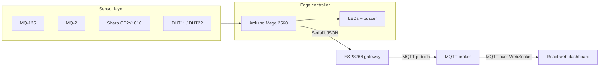

# AirGuard IoT

> An IoT-based air-quality, combustible-gas, dust, temperature and humidity monitoring system with an MQTT-connected web dashboard.

AirGuard combines an **Arduino Mega 2560** sensor node, an **ESP8266** Wi-Fi/MQTT gateway, and a responsive **React web dashboard**. The Mega samples the sensors and controls the local buzzer/LED indicators. The ESP8266 forwards the JSON telemetry to an MQTT broker. The web app subscribes to that topic and displays live readings, trends, alerts and history.

## Team and course

- **Institution:** University of Information Technology and Sciences (UITS)
- **Department:** Computer Science & Engineering
- **Course:** CSE402 — Internet of Things Lab
- **Semester:** 7th Semester (Autumn 2026)
- **Team:** MD. Fahad Rahman (Team Leader), Zannatul Nayem, Shafayet Hossain Shafin
- **Batch / Section:** 54th Batch / 6B1

## Repository structure

```text
AirGuard-IoT-Team/
├── web/                         # React + Vite monitoring dashboard
│   ├── public/                  # Static assets and favicon
│   ├── scripts/                 # MQTT sample publisher
│   ├── src/
│   │   ├── components/          # Dashboard UI components
│   │   ├── context/             # Telemetry state/provider
│   │   ├── hooks/               # React hooks
│   │   ├── lib/                 # MQTT, parsing, alerts, storage, CSV
│   │   └── pages/               # Dashboard, history and settings
│   ├── package.json
│   └── vite.config.js
├── firmware/
│   ├── arduino_airguard/        # Mega 2560 sensor acquisition + local alarms
│   └── esp8266_gateway/         # Wi-Fi + MQTT gateway
├── hardware/
│   ├── pinout.md                # Wiring and voltage-level guidance
│   └── bill_of_materials.md     # Hardware component list
├── docs/
│   ├── architecture.md          # End-to-end system design
│   ├── telemetry-contract.md    # Firmware-to-dashboard MQTT contract
│   ├── assets/                  # Proposal assets
│   └── proposal/                # Project proposal documents
├── LICENSE
└── README.md
```

## System architecture



## Quick start — web dashboard

**Prerequisites:** Node.js 22.22.2+ (or Node.js 24.15.0+) and npm. Use a current Node LTS release to satisfy the frontend toolchain's engine requirements.

```bash
cd web
npm ci
npm run dev
```

Open the local URL printed by Vite (normally `http://localhost:5173`). The dashboard starts in **demo mode**, so it can be explored without connecting hardware.

### Frontend checks

Run from the `web/` directory:

```bash
npm test
npm run lint
npm run build
npm run test:coverage
```

The production build is written to `web/dist/` (generated locally; not committed).

## Quick start — hardware and firmware

### 1. Arduino Mega 2560

1. Install Arduino IDE 2.x.
2. Install the **DHT sensor library by Adafruit** (and its required Adafruit Unified Sensor dependency if prompted).
3. Open `firmware/arduino_airguard/arduino_airguard.ino`.
4. Select **Arduino Mega or Mega 2560** and the correct COM port, then upload.

The Mega sends one JSON telemetry line every three seconds through `Serial1` (TX1 pin 18 / RX1 pin 19).

### 2. ESP8266 gateway

1. Install the ESP8266 board support package in Arduino IDE.
2. Install **PubSubClient** by Nick O'Leary.
3. Open `firmware/esp8266_gateway/esp8266_gateway.ino`.
4. Set `WIFI_SSID` and `WIFI_PASSWORD` for your 2.4 GHz Wi-Fi network.
5. Confirm the broker and topic match the web dashboard settings.
6. Select the correct ESP8266 board and COM port, then upload.

**Never commit real Wi-Fi credentials.** Keep the placeholder values in the shared repository and enter local credentials only in your own working copy.

### 3. Connect the dashboard

1. Open the dashboard and go to **Settings**.
2. Turn demo mode off.
3. Set the broker WebSocket URL to `wss://broker.hivemq.com:8884/mqtt` (or your broker's WebSocket endpoint).
4. Set the topic to `airguard/telemetry`.
5. Save settings and confirm the connection status changes to Live when the gateway publishes messages.

The ESP8266 firmware currently publishes to the public HiveMQ TCP endpoint on port `1883`; the browser connects to the broker's WebSocket endpoint on port `8884`. Both transports use the same broker and topic.

## MQTT telemetry contract

The Mega emits the following JSON shape and the ESP8266 publishes it unchanged:

```json
{"temp":28.5,"hum":65.0,"aqi":180,"gas":95,"dust":34.2}
```

| Field | Source | Meaning | Accepted range |
|---|---|---|---:|
| `temp` | DHT11/DHT22 | Temperature in °C | -40 to 85 |
| `hum` | DHT11/DHT22 | Relative humidity (%) | 0 to 100 |
| `aqi` | MQ-135 | Raw ADC reading (not a calibrated AQI index) | 0 to 1023 |
| `gas` | MQ-2 | Raw ADC reading (not ppm) | 0 to 1023 |
| `dust` | Sharp GP2Y1010 | Estimated dust density (µg/m³) | 0 to 1000 |
| `o2` | Reserved future sensor | Oxygen (%) — optional, Phase 2 only | 0 to 25 |

See [docs/telemetry-contract.md](docs/telemetry-contract.md) for validation rules, thresholds and integration details.

## Hardware wiring

See [hardware/pinout.md](hardware/pinout.md) before wiring. In particular, the Mega's 5V TX1 signal must be reduced to a safe 3.3V logic level before it reaches the ESP8266 RX pin. Use a regulated 3.3V supply capable of handling the ESP8266's peak current requirements.

## Project documents

- [Project architecture](docs/architecture.md)
- [Telemetry contract](docs/telemetry-contract.md)
- [Hardware pinout](hardware/pinout.md)
- [Bill of materials](hardware/bill_of_materials.md)
- [Project proposal (PDF)](docs/proposal/AirGuard_IoT_Project_Proposal.pdf)
- [Project proposal (Markdown)](docs/proposal/project_proposal.md)

## Important limitations

- The default MQTT topic and public broker are suitable for a classroom prototype, not production or safety-critical use. Public topics can be read or spoofed by others; use a private authenticated broker for real deployments.
- MQ-135 and MQ-2 values are raw ADC readings. They are not calibrated AQI, ppm or certified gas concentration measurements.
- Oxygen sensing is not installed in Phase 1. Pin A2 is reserved for a future upgrade.
- Dashboard history and settings are stored in the current browser's local storage; they are not synchronized across users or devices.
- The dashboard is a monitoring aid and is not a replacement for certified smoke, fire or gas safety equipment.

## License

This project is distributed under the MIT License. See [LICENSE](LICENSE).
