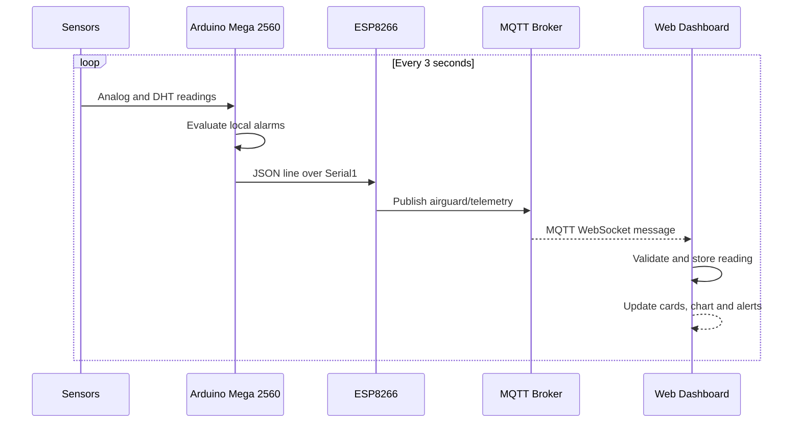

# AirGuard IoT — System Architecture

## Overview

AirGuard uses a three-stage data path:

1. **Sensing and edge processing:** the Arduino Mega 2560 reads the MQ-135, MQ-2, Sharp GP2Y1010 dust sensor and DHT11/DHT22. It evaluates the local air/gas thresholds and drives the buzzer and status LEDs.
2. **Connectivity:** the Mega sends newline-delimited JSON through hardware UART `Serial1` to the ESP8266. The ESP8266 joins a 2.4 GHz Wi-Fi network and publishes the JSON to an MQTT broker.
3. **Web monitoring:** the React application connects to the broker through MQTT over WebSocket, validates incoming telemetry, and renders current values, trends, alerts and browser-local history.

## Responsibilities

| Component | Responsibility |
|---|---|
| Arduino Mega 2560 | Sensor sampling, local threshold decisions, buzzer/LED output, serial telemetry |
| ESP8266 | Wi-Fi connectivity and MQTT publishing |
| MQTT broker | Message transport between gateway and browser clients |
| React dashboard | Telemetry validation, visualization, history, CSV export and user-configurable thresholds |

## Data flow

## UART connection

- Mega TX1, pin 18 → ESP8266 RX through a 5V-to-3.3V voltage divider.
- ESP8266 TX → Mega RX1, pin 19.
- Share ground between the two boards.
- Power the ESP8266 from a suitable regulated 3.3V supply, not an underpowered 3.3V pin.

See [../hardware/pinout.md](../hardware/pinout.md) for wiring details.

## Current design boundaries

- There is no backend API or shared database in this version.
- The browser subscribes directly to MQTT over WebSocket.
- The dashboard's settings and history are per-browser local storage.
- The local buzzer/LED alarm is controlled by the Mega and does not depend on browser connectivity.
- Oxygen sensing is reserved for a future phase and is not part of the active hardware build.
